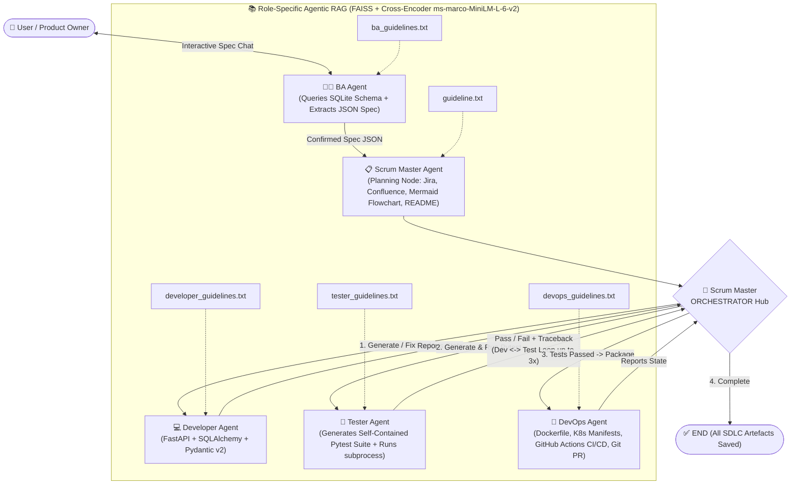

# Spec-Driven Multi-Agent AI System in SDLC (`AI-SDLC Accelerator`)

An end-to-end **Spec-Driven Software Development Lifecycle (SDLC) Multi-Agent System** built with **LangGraph**, **Agentic RAG (`FAISS` + `Cross-Encoder` Reranking)**, **Automated `pytest` Unit & Edge-Case Generation**, **FastAPI**, **SQLite**, and **Streamlit**.

From natural-language business requirements, 5 specialized agents collaborate in a **Hub-and-Spoke LangGraph architecture** to inspect live database schemas, extract a formal JSON specification, generate Jira/Confluence planning documents, write modular FastAPI + SQLAlchemy code, generate and execute self-contained `pytest` suites in a closed-loop **Developer $\leftrightarrow$ Tester self-healing cycle**, and output Docker/Kubernetes/GitHub Actions CI/CD configurations with automated GitHub Pull Request creation.

---

## System Architecture (Hub-and-Spoke LangGraph + Agentic RAG)



---

## Core Engineering Capabilities

1. **Interactive Spec-Driven Requirement Engineering (`agents/ba_agent.py`)**
   - Inspects the live SQLite database schema and sample rows (`database/db_manager.py`) and conducts a multi-turn requirement interview with the user.
   - Extracts a formal, validated JSON API Specification (`endpoints`, `models`, `auth_type`, `business_rules`, `non_functional` requirements) once confirmed (`[SPEC_CONFIRMED]`).

2. **Two-Stage Agentic RAG with Cross-Encoder Reranking (`rag/retriever.py`, `rag/loader.py`)**
   - Splits role-specific engineering standards (`guidelines/*.txt`) using `RecursiveCharacterTextSplitter` (`chunk_size=800`, `chunk_overlap=150`).
   - **Stage 1 (Bi-Encoder Recall)**: Retrieves top-$k=15$ candidate chunks from **FAISS** using `OpenAIEmbeddings`.
   - **Stage 2 (Cross-Encoder Precision)**: Re-scores `(query, chunk)` pairs using `sentence-transformers` **`cross-encoder/ms-marco-MiniLM-L-6-v2`** to inject the top-$5$ to top-$8$ most relevant rules into each agent's prompt.

3. **Hub-and-Spoke Multi-Agent Orchestration (`agents/graph.py`, `agents/scrum_master.py`)**
   - Uses `StateGraph(AgentState)` compiled with `MemorySaver` checkpointing.
   - Every specialist agent reports back to the central **Scrum Master Orchestrator**, which evaluates full pipeline state (`current_phase`, `has_api_code`, `test_passed`, `retry_count`) to dynamically route execution.

4. **Automated Test Case Generation & Closed-Loop Self-Healing (`agents/tester.py`, `agents/developer.py`)**
   - The **Tester Agent** parses the confirmed JSON specification and generated FastAPI service logic to synthesize self-contained **`pytest` test suites** (`conftest.py` + `test_<entity>.py`) backed by an in-memory SQLite fixture (`sqlite:///:memory:`).
   - Covers **CRUD operations, boundary/edge cases (missing fields, duplicates, not-found), and domain business rules**.
   - Executes `python -m pytest -v --tb=short -x` via `subprocess.run()`. If any test fails, the Orchestrator routes the exact `pytest` traceback back to `DeveloperAgent.fix_code()` for up to `max_retries = 3` automated repair cycles.

5. **DevOps & Automated GitHub PR Creation (`agents/devops.py`, `utils/git_utils.py`)**
   - Generates multi-stage `Dockerfile`, `docker-compose.yml`, Kubernetes manifests (`deployment.yaml`, `service.yaml`, `configmap.yaml`, `hpa.yaml`), and `.github/workflows/ci-cd.yml`.
   - Automatically initializes a Git branch (`feature/<project>-stub`), commits all artifacts, pushes to GitHub, and opens a Pull Request via the GitHub REST API.

---

## Repository Structure

```text
Spec-Driven-Multi-Agent-SDLC/
├── app.py                              # 6-tab Streamlit UI (Spec Chat, Planning, Code, Tests, DevOps, Dashboard)
├── agents/
│   ├── state.py                        # TypedDict AgentState schema shared across LangGraph nodes
│   ├── graph.py                        # Hub-and-spoke StateGraph definition & MemorySaver compilation
│   ├── ba_agent.py                     # Business Analyst Agent (DB schema inspection + JSON spec extraction)
│   ├── scrum_master.py                 # Planning node (Jira/Confluence/Mermaid) & central Orchestrator node
│   ├── developer.py                    # Developer Agent (FastAPI/SQLAlchemy generation & test-driven bug fixing)
│   ├── tester.py                       # Tester Agent (Automated pytest suite generation & subprocess runner)
│   ├── devops.py                       # DevOps Agent (Docker, K8s, GitHub Actions CI/CD & PR creation)
│   └── prompts.py                      # Structured system prompts & output contracts for all 5 agents
├── rag/
│   ├── loader.py                       # Markdown-aware RecursiveCharacterTextSplitter pipeline
│   └── retriever.py                    # FAISS vector index + CrossEncoder (ms-marco-MiniLM-L-6-v2) reranker
├── guidelines/                         # Role-specific engineering & QA standards retrieved via RAG
│   ├── ba_guidelines.txt
│   ├── developer_guidelines.txt
│   ├── tester_guidelines.txt
│   └── devops_guidelines.txt
├── database/
│   └── db_manager.py                   # SQLite DatabaseManager with schema introspection & seed data
├── utils/
│   ├── parsers.py                      # Resilient JSON parser with automatic LLM self-repair fallback
│   ├── file_utils.py                   # Artifact persistence manager
│   └── git_utils.py                    # GitPython branch automation & GitHub Pull Request client
├── notebooks/
│   └── AI_SDLC_Walkthrough.ipynb       # Step-by-step interactive walkthrough of every subsystem
└── requirements.txt                    # Project dependencies
```

---

## Quick Start

### 1. Install Dependencies
```bash
pip install -r requirements.txt
```

### 2. Configure Environment Variables
```bash
cp .env.example .env
# Set OPENAI_API_KEY (and optional GITHUB_TOKEN, GITHUB_REPO_OWNER, GITHUB_REPO_NAME)
```

### 3. Launch the Streamlit Platform
```bash
streamlit run app.py
```
