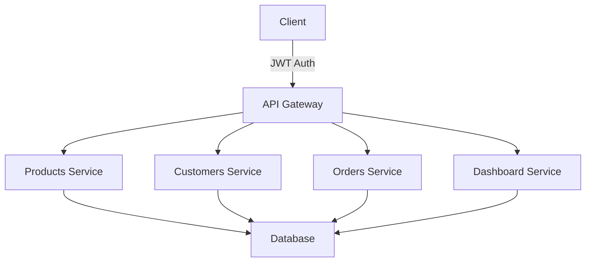

# Product Inventory and Order Management API

## Setup Instructions
1. **Clone the repository**
   ```bash
   git clone <repository-url>
   cd project_name
   ```

2. **Create a virtual environment and activate it**
   ```bash
   python3 -m venv venv
   source venv/bin/activate
   ```

3. **Install dependencies**
   ```bash
   pip install -r requirements.txt
   ```

4. **Run the application**
   ```bash
   uvicorn app.main:app --reload
   ```

## Usage
- Access the API documentation at `http://localhost:8000/docs`
- Use the provided endpoints to manage products, customers, and orders

## Architecture Diagram


## Endpoints Table
| Method | Endpoint | Description |
|--------|----------|-------------|
| GET | /api/v1/products | List all products |
| GET | /api/v1/products/{product_id} | Get a single product |
| POST | /api/v1/products | Create a new product |
| PATCH | /api/v1/products/{product_id}/stock | Update stock quantity |
| PATCH | /api/v1/products/{product_id}/deactivate | Deactivate a product |
| GET | /api/v1/customers | List all customers |
| GET | /api/v1/customers/{customer_id} | Get a customer by ID |
| POST | /api/v1/customers | Create a new customer |
| PATCH | /api/v1/customers/{customer_id} | Update customer info |
| POST | /api/v1/orders | Place a new order |
| GET | /api/v1/orders | List orders |
| GET | /api/v1/orders/{order_id} | Get order details |
| PATCH | /api/v1/orders/{order_id}/status | Update order status |
| GET | /api/v1/dashboard | Retrieve dashboard metrics |